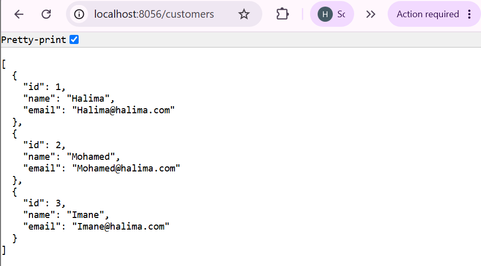
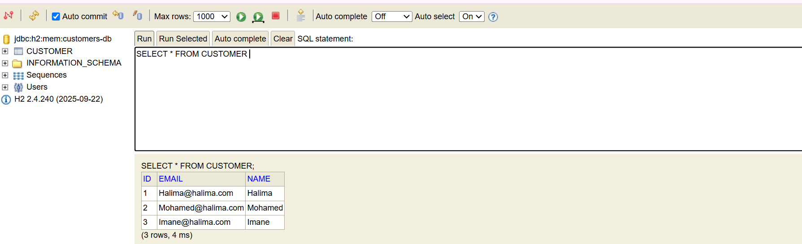
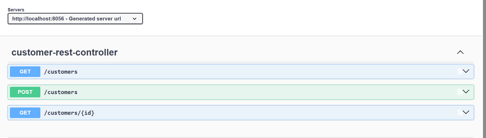
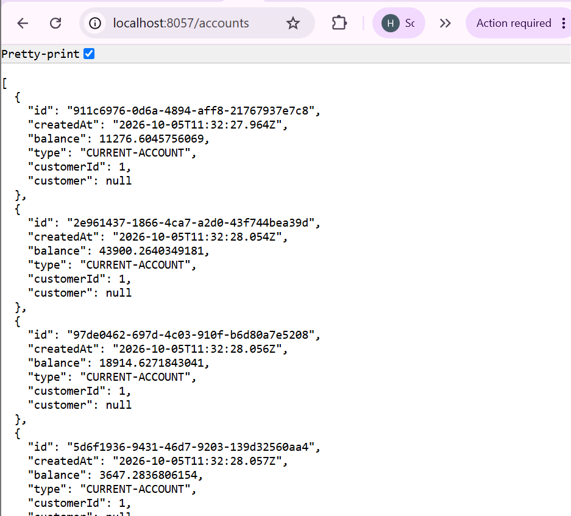
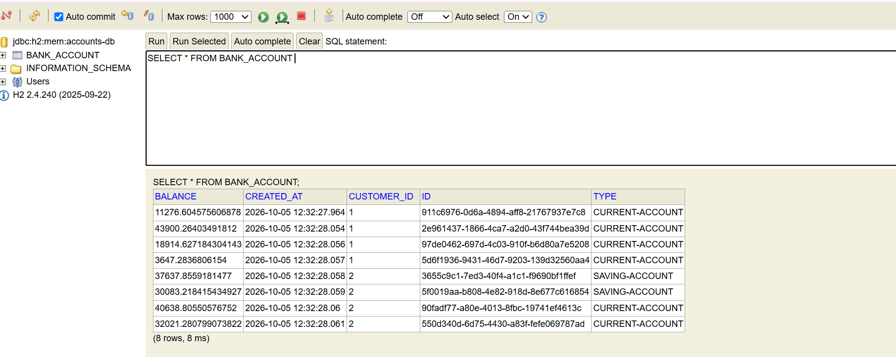
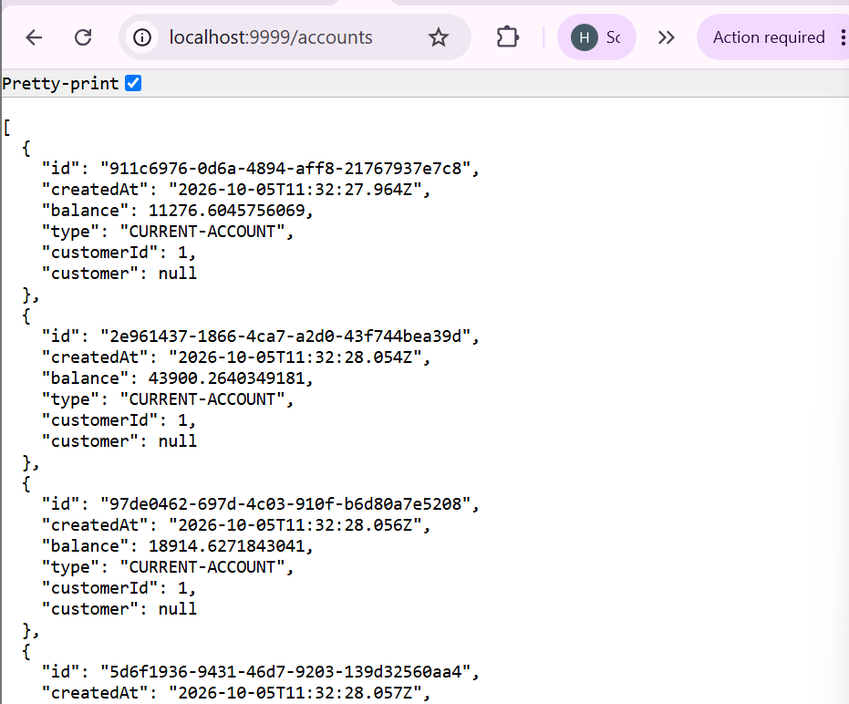
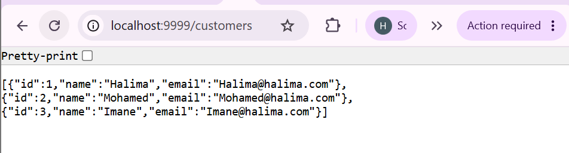
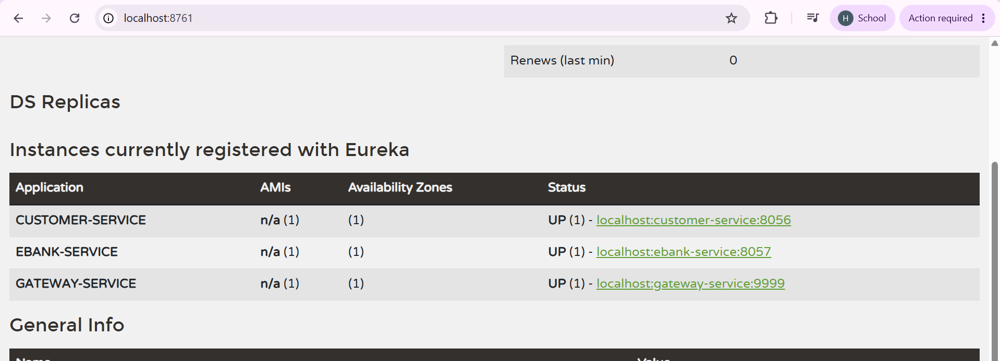
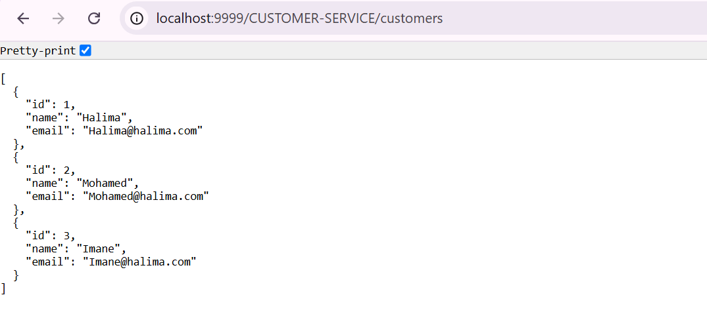
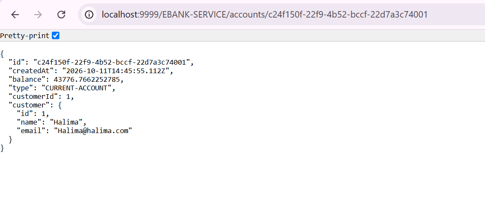

# Projet E-Bank : Partie 1 (Architecture Microservices)

Cette première partie met en place une architecture microservices avec **Spring Boot** et **Spring Cloud** : deux services métier, une gateway, un service de découverte, la communication inter-services avec OpenFeign et la tolérance aux pannes avec Resilience4J.


## Objectifs

- Développer le service **Customer-Service**
- Développer le service **EBank-Service**
- Faire communiquer les deux services avec **OpenFeign**
- Mettre en place la **tolérance aux pannes** avec le **Circuit Breaker (Resilience4J)**
- Développer la **Gateway**
- Développer le **Discovery Service** (Eureka)
- Tester les services backend avec **Postman** et **Swagger-UI**

## Technologies utilisées

Java, Spring Boot, Spring Data JPA, Spring Cloud Gateway, Spring Cloud Netflix Eureka, Spring Cloud OpenFeign, Resilience4J, Swagger-UI (OpenAPI), Postman, Maven.


## Architecture

```
                    ┌──────────────────┐
   Client REST ───► │     Gateway      │
 (Postman/Swagger)  └────────┬─────────┘
                             │
              ┌──────────────┴───────────────┐
              ▼                              ▼
     ┌─────────────────┐   OpenFeign   ┌─────────────────┐
     │ Customer-Service│ ◄──────────── │  EBank-Service  │
     └────────┬────────┘               └────────┬────────┘
              └──────────┐      ┌───────────────┘
                         ▼      ▼
                  ┌───────────────────┐
                  │ Discovery Service │
                  │     (Eureka)      │
                  └───────────────────┘
```

---

## 1. Customer-Service

Ce service gère les clients (CRUD). Il expose une API REST, par exemple `GET /customers/{id}`, et s'enregistre auprès d'Eureka sous le nom `customer-service`.

Premiers tests de l'API :







---

## 2. EBank-Service (Accounts-Service)

Ce service gère les comptes bancaires. Chaque compte est associé à un client, dont les informations sont récupérées auprès de Customer-Service. Il s'enregistre sous le nom `ebank-service` (port `8057`).

Premiers tests de l'API :







## 3. Gateway : routage statique

La Gateway est le point d'entrée unique de l'application. Avec le **routage statique**, chaque route est déclarée manuellement avec l'adresse (hôte et port) du microservice cible.






## 4. Discovery Service (Eureka) : routage dynamique

Le Discovery Service est l'annuaire des microservices : chaque service s'y enregistre et peut être retrouvé par son nom (`spring.application.name`). Avec le **routage dynamique**, la Gateway n'a plus besoin de connaître les adresses : elle les récupère depuis Eureka.





## 5. Communication entre services avec OpenFeign

EBank-Service appelle Customer-Service de façon déclarative grâce à un client Feign. Le nom du service est résolu via Eureka :

```java
@FeignClient(name = "customer-service")
public interface CustomerRestClient {
    @GetMapping("/customers/{id}")
    Customer getCustomersById(@PathVariable Long id);
}
```

Résultat : les informations du client sont bien récupérées et intégrées dans la réponse d'EBank-Service.




## 6. Tolérance aux pannes : Circuit Breaker (Resilience4J)

Si Customer-Service est indisponible, le Circuit Breaker évite de propager l'erreur et déclenche une méthode de secours (*fallback*) qui renvoie un client par défaut :

```java
@CircuitBreaker(name = "customerService", fallbackMethod = "getDefaultCustomer")
public Customer fetchCustomer(Long id) {
    return customerRestClient.getCustomersById(id);
}

public Customer getDefaultCustomer(Long id, Exception e) {
    return new Customer(id, "Default Customer name", "Default Customer email");
}
```

Test avec Customer-Service arrêté : le client par défaut est renvoyé.


## Lancement du projet

L'ordre de démarrage est important :

1. **Discovery Service** (Eureka)
2. **Customer-Service**
3. **EBank-Service** (attendre que `CUSTOMER-SERVICE` apparaisse dans le dashboard Eureka)
4. **Gateway**

> ⚠️ Si EBank-Service démarre avant que Customer-Service soit visible dans Eureka, l'erreur `Load balancer does not contain an instance for the service customer-service` peut apparaître.


## Auteur

**Halima Idouaksim**