# Projet E-Bank : Partie 3 (Frontend Angular)

Cette troisième partie ajoute une **application web Angular** à l'architecture des parties 1 et 2. Elle permet de gérer les comptes bancaires depuis une interface et de dialoguer avec l'**agent AI (chatbot)** directement dans le navigateur, avec un affichage des réponses en **streaming** et un rendu **Markdown**.


## Objectifs

- Mettre en place l'application **Angular** et intégrer **Bootstrap 5**
- Développer le composant **Accounts** (création et affichage de la liste des comptes)
- Gérer les **exceptions** et afficher des messages d'erreur à l'utilisateur
- Développer le composant **Bot** (interface du chatbot)
- Afficher les réponses de l'agent avec un rendu **Markdown**
- Ajouter un **intercepteur HTTP**
- Afficher les réponses du chatbot en **streaming**

## Technologies utilisées

Angular, TypeScript, Bootstrap 5, RxJS, HttpClient, npm.


## Architecture

```
        ┌──────────────────────┐
        │   Application Angular │
        │  (Accounts + Bot)     │
        └─────────┬─────────────┘
                  │ HTTP
        ┌─────────┴──────────┐
        ▼                    ▼
 ┌─────────────┐      ┌───────────────┐
 │   Gateway   │      │   Agent AI    │
 └──────┬──────┘      │   (Chatbot)   │
        │             └───────┬───────┘
        ▼                     │ MCP
 Customer-Service /           ▼
 EBank-Service        Customer-Service /
                      EBank-Service
```

---

## 1. Intégration de Bootstrap 5 : barre de navigation

Bootstrap 5 est intégré au projet pour le style de l'application. Une **navbar** permet de naviguer entre les différentes pages (comptes, chatbot).

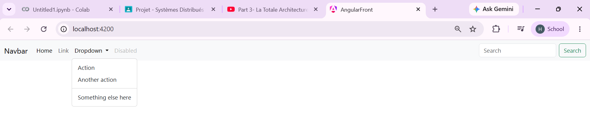

---

## 2. Composant Accounts

### Création du composant

Le composant **Accounts** est créé pour gérer les comptes bancaires depuis l'interface.

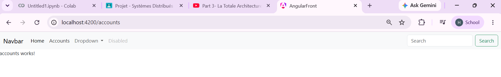

### Affichage de la liste des comptes

Les comptes sont récupérés auprès du backend (via la Gateway) et affichés dans un tableau.

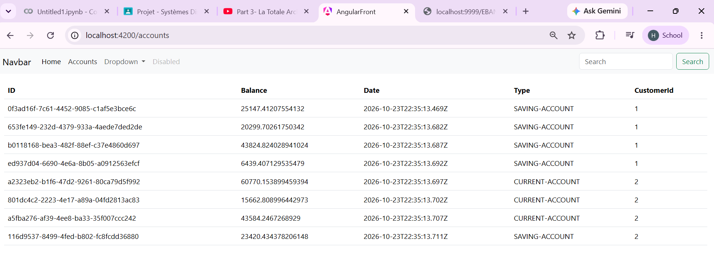

### Gestion des exceptions

En cas d'erreur (service indisponible, requête invalide, etc.), l'application affiche un message clair à l'utilisateur au lieu de rester bloquée.

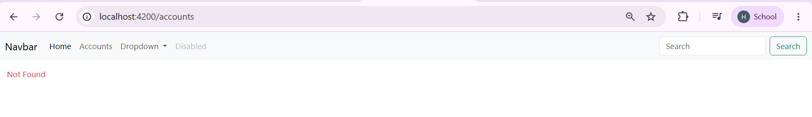

---

## 3. Composant Bot

### Interface du chatbot

Le composant **Bot** fournit une zone de saisie et l'historique de la conversation avec l'agent AI.

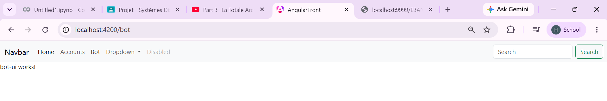

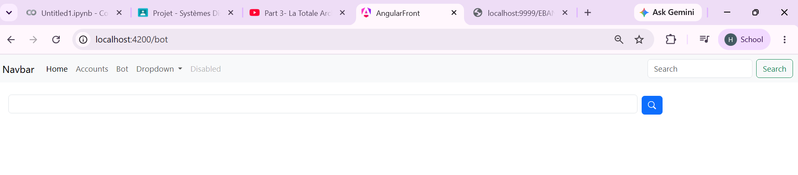

### Réponse du bot

La question de l'utilisateur est envoyée à l'agent AI, et sa réponse est affichée dans la conversation.

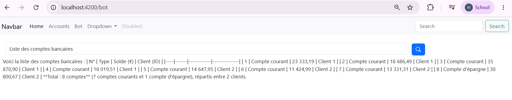

### Rendu Markdown

Les réponses de l'agent contiennent souvent du Markdown (listes, tableaux, texte en gras). Elles sont converties en HTML pour un affichage lisible.

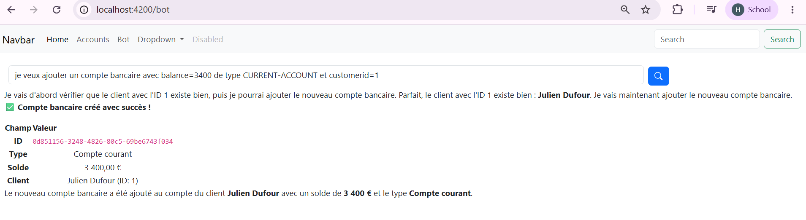

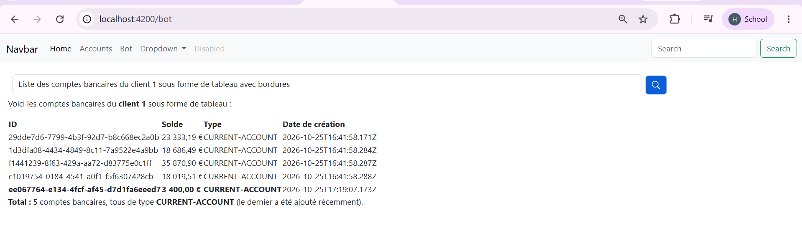

---

## 4. Intercepteur HTTP

Un **intercepteur HTTP** Angular est ajouté pour traiter les requêtes et les réponses de façon centralisée, sans répéter le code dans chaque composant.

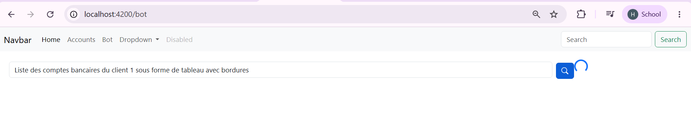

---

## 5. Streaming des réponses

Au lieu d'attendre la réponse complète de l'agent, l'application l'affiche **progressivement**, au fur et à mesure qu'elle est générée, ce qui améliore l'expérience utilisateur.

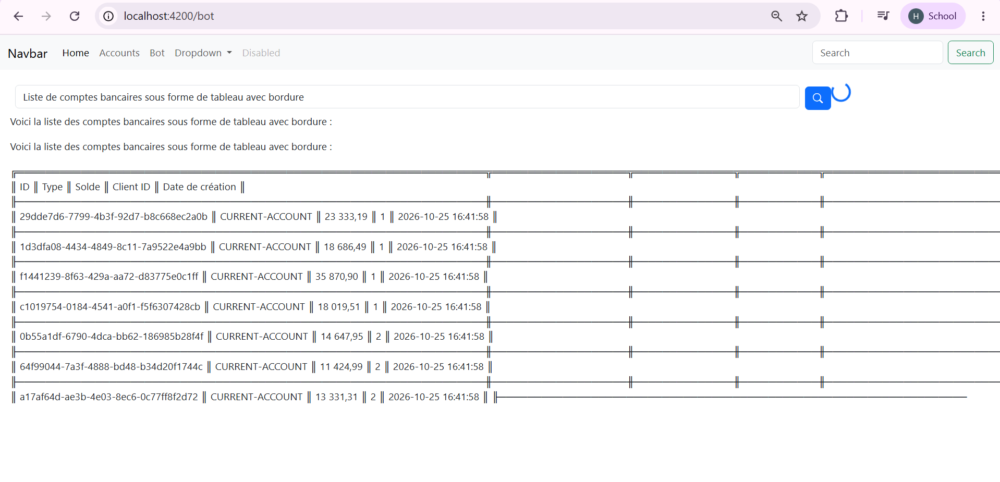

---

## Lancement du projet

### Backend

L'ordre de démarrage recommandé (voir les parties 1 et 2) :

1. **Discovery Service** (Eureka)
2. **Customer-Service** et **EBank-Service**
3. **Gateway**
4. **Agent AI** (chatbot)

### Frontend

```bash
npm install
ng serve
```

L'application est disponible sur `http://localhost:4200`.

> ⚠️ Le backend doit être démarré avant le frontend, sinon la liste des comptes et le chatbot afficheront des erreurs de connexion.


## Auteur

**Halima Idouaksim**
