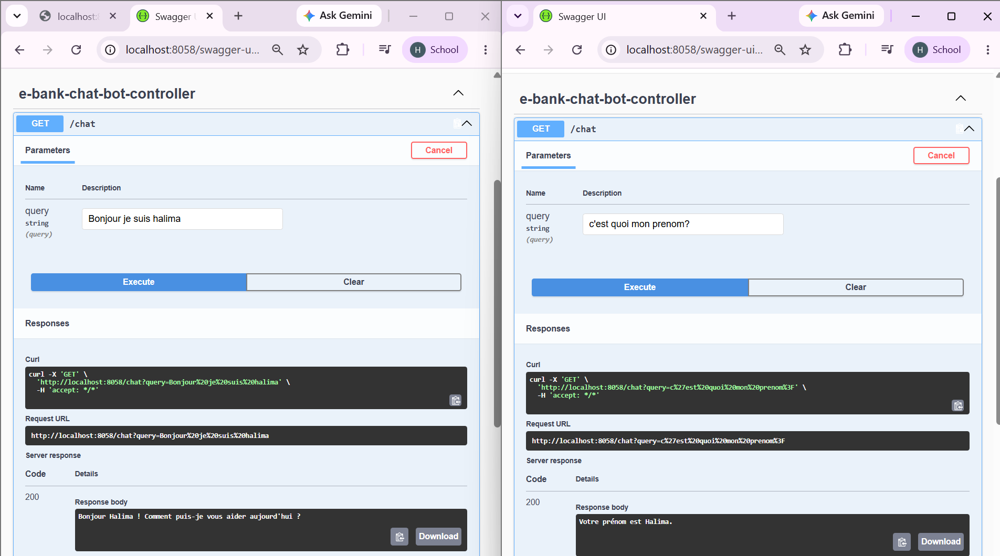
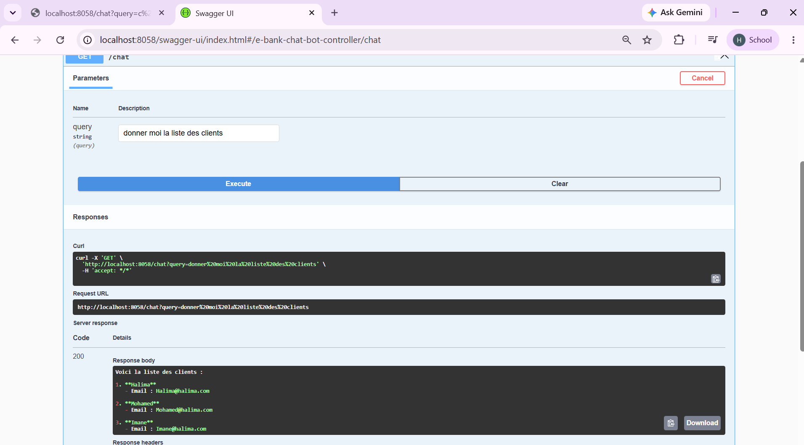
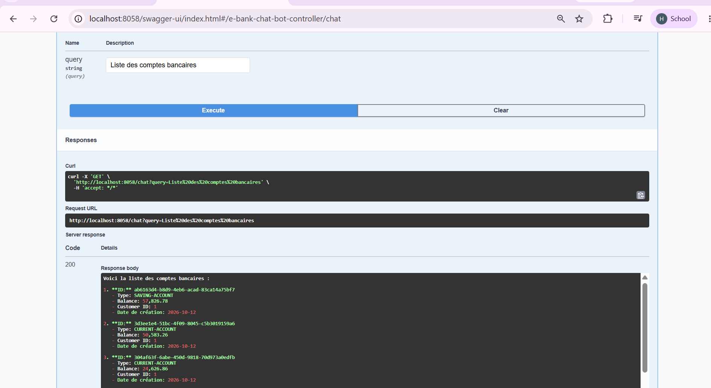
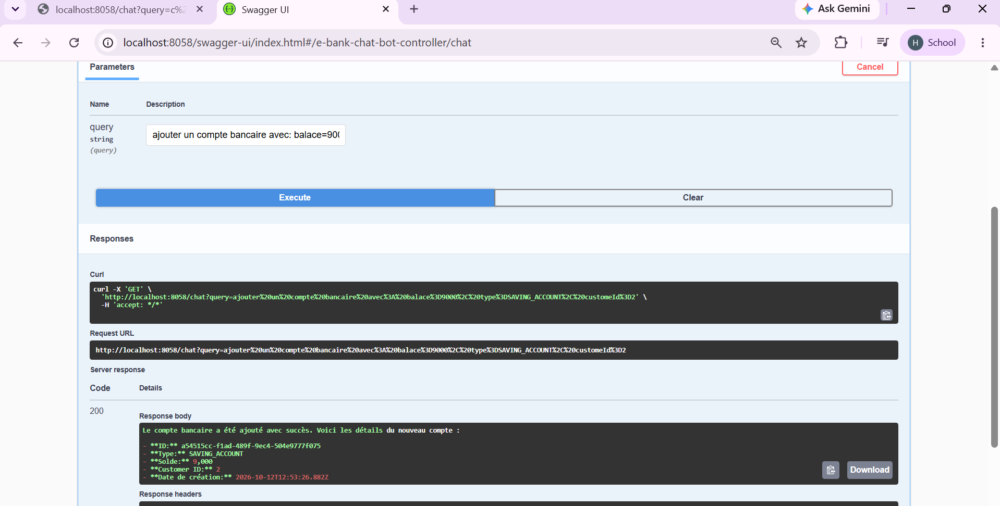

# Projet E-Bank : Partie 2 (Agent AI)

1er test

test swagger 

memory for the bot

connexion du chatbot avec customer-service via mcp

system prompt

connexion du chatbot avec ebank-service via mcp

find by id

save
