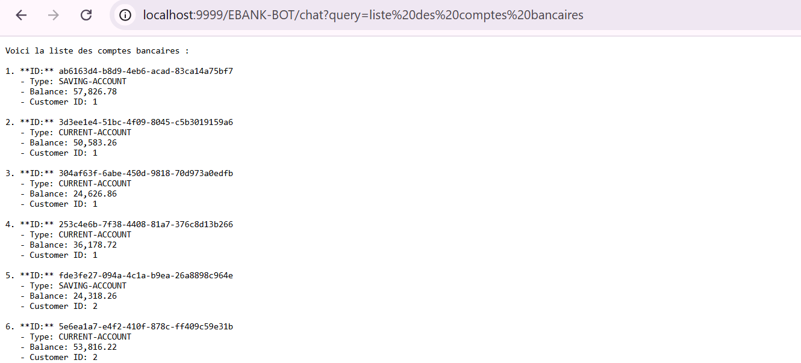
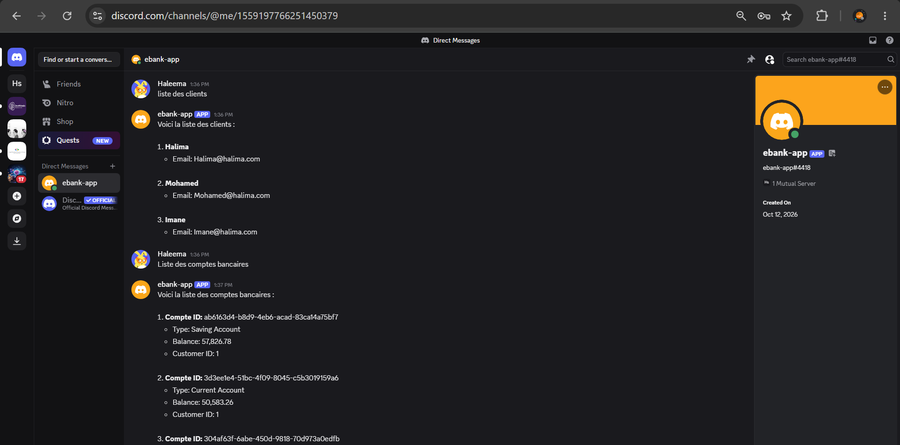
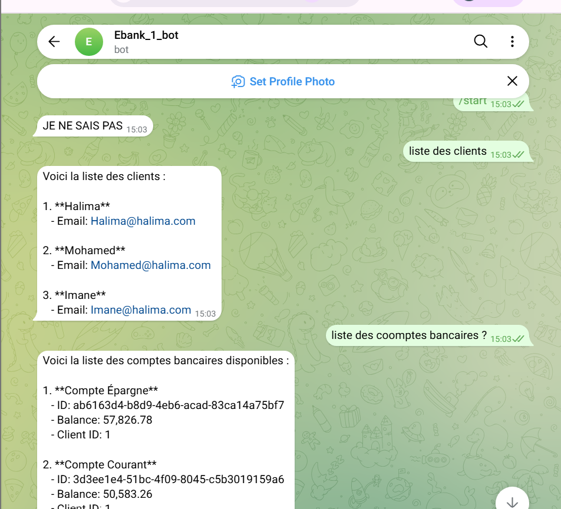

# Projet E-Bank : Partie 2 (Agent AI)

Cette deuxième partie ajoute un **agent AI (chatbot)** à l'architecture microservices de la partie 1. L'agent est développé avec **Spring AI** et interagit avec les microservices **Customer-Service** et **EBank-Service** grâce au protocole **MCP (Model Context Protocol)**. Il est ensuite testé avec un client REST, Discord et Telegram.


## Objectifs

- Développer l'**Agent AI** basé sur **Spring AI**
- Exposer les fonctionnalités des microservices via **MCP**
- Tester les microservices via un **MCP Client**
- Connecter le chatbot aux microservices avec MCP
- Tester le chatbot avec un **client REST**
- Tester le chatbot avec un **client Telegram**
- Tester le chatbot avec un **client Discord**

## Technologies utilisées

Java, Spring Boot, Spring AI, MCP (Model Context Protocol), Spring Cloud Gateway, Eureka, OpenFeign, Swagger-UI (OpenAPI), Telegram, Discord, Maven.

---

## Architecture

```
  Discord / Telegram / Client REST
                │
                ▼
        ┌───────────────┐
        │   Agent AI    │  (Spring AI + mémoire + system prompt)
        │   (Chatbot)   │
        └───────┬───────┘
                │ MCP
      ┌─────────┴──────────┐
      ▼                    ▼
┌──────────────┐   ┌──────────────┐
│ Customer-    │   │  EBank-      │
│ Service      │   │  Service     │
│ (MCP Server) │   │ (MCP Server) │
└──────────────┘   └──────────────┘
```

---

## 1. Développement de l'Agent AI avec Spring AI

L'agent AI est un service Spring Boot qui s'appuie sur **Spring AI** pour dialoguer avec un modèle de langage (openai) et exposer le chatbot via une API REST.

### Premier test

Premier échange avec l'agent : le modèle répond correctement aux questions de l'utilisateur.


### Test avec Swagger-UI

L'endpoint du chatbot est également testé depuis Swagger-UI.


### Mémoire du chatbot

Pour que l'agent se souvienne du contexte de la conversation, une **mémoire de chat** est ajoutée : il peut ainsi répondre à des questions qui font référence aux messages précédents.


---

## 2. Exposition des microservices via MCP

Le **Model Context Protocol (MCP)** est un protocole standard qui permet à un LLM d'utiliser des outils externes. Les fonctionnalités des microservices **Customer-Service** et **EBank-Service** sont exposées comme des *tools* MCP, afin que l'agent puisse les appeler. Elles peuvent d'abord être testées avec un MCP Client avant d'être connectées au chatbot.

---

## 3. Connexion du chatbot avec Customer-Service via MCP

L'agent AI est configuré comme **client MCP** de Customer-Service. Il peut maintenant consulter les informations des clients à partir de simples questions en langage naturel.


### System prompt

Un **system prompt** définit le rôle de l'agent, son comportement et la manière d'utiliser les outils mis à sa disposition.


---

## 4. Connexion du chatbot avec EBank-Service via MCP

L'agent est ensuite connecté à EBank-Service, ce qui lui permet de gérer les comptes bancaires.


### Recherche d'un compte par identifiant (find by id)


### Création d'un compte (save)


---

## 5. Test avec la Gateway

Les appels passent maintenant par la **Gateway** de la partie 1, qui redirige les requêtes vers les microservices grâce au Discovery Service.



---

## 6. Test du chatbot avec un client Discord

Le chatbot est connecté à un bot **Discord** : on peut dialoguer avec l'agent directement depuis un serveur Discord.



---

## 7. Test du chatbot avec un client Telegram

Le chatbot est aussi connecté à un bot **Telegram**.



---

## Lancement du projet

L'ordre de démarrage recommandé :

1. **Discovery Service** (Eureka)
2. **Customer-Service** et **EBank-Service** (avec leur serveur MCP)
3. **Gateway**
4. **Agent AI** (chatbot)


## Auteur

**Halima Idouaksim**